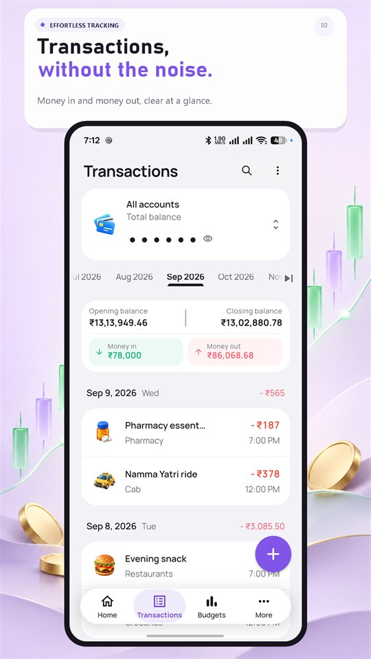
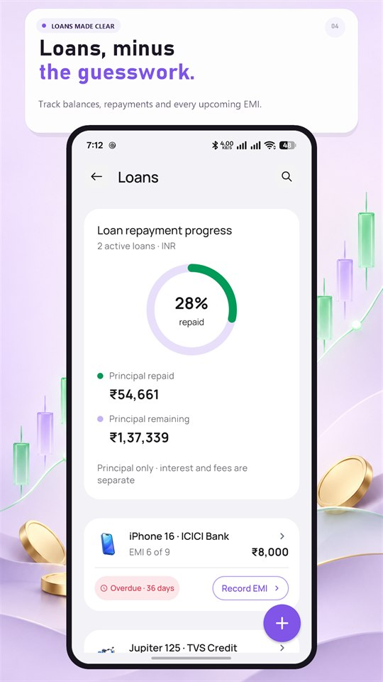

<div align="center">

[](https://play.google.com/store/apps/details?id=com.aash591.SimpleMoney)

# SimpleMoney

**A free, private expense manager and budget planner for Android.**<br>
No account. Works offline. Reads your bank SMS. Your data stays on your phone.

<p>
  <a href="https://play.google.com/store/apps/details?id=com.aash591.SimpleMoney"></a>
  <a href="https://simplemoney.aashglobal.in"></a>
  <a href="https://simplemoney.aashglobal.in/privacy"></a>
</p>


</div>

## Screenshots

<table>
  <tr>
    <td align="center"></td>
    <td align="center"></td>
    <td align="center"></td>
    <td align="center"></td>
  </tr>
  <tr>
    <td align="center"><b>Home</b></td>
    <td align="center"><b>Transactions</b></td>
    <td align="center"><b>Budgets</b></td>
    <td align="center"><b>Loans</b></td>
  </tr>
  <tr>
    <td align="center"></td>
    <td align="center"></td>
    <td align="center"></td>
    <td align="center"></td>
  </tr>
  <tr>
    <td align="center"><b>Recurring payments</b></td>
    <td align="center"><b>AI assistant</b></td>
    <td align="center"><b>Aurora glass</b></td>
    <td align="center"><b>Make it yours</b></td>
  </tr>
</table>

## Overview

SimpleMoney is built around one small idea. Every transaction answers two questions, and the app keeps them apart:

- **What was it for?** That is the **category** (Food, Fuel, Bills…).
- **Where did the money come from?** That is the **account** (Cash, bank, card, wallet…).

Food paid from Cash and Food paid from a bank are both just **Food**. Moving money between your own accounts is a transfer, not spending.

### How it works

1. **Your bank SMS arrives.** SimpleMoney reads it on your phone and turns it into a transaction waiting for review. Nothing is uploaded.
2. **You check it.** Confirm, fix the category, or skip. Prefer to type? Adding an expense is amount, category, account, save.
3. **You see where you stand.** Budgets, balances, loans, bills due and net savings update on the Home screen.

## Why SimpleMoney

**Key differences**

- **Private by design.** No sign-up, no login, no server holding your transactions. Bank SMS is read on the device.
- **Works in your country.** Ready-made bank SMS rules for 25+ countries, and a way to teach the app any bank it doesn't know.
- **More than an expense log.** Loans and EMIs, debts between people, recurring bills, multi-currency accounts and an investment portfolio, all in one app.
- **AI that asks first.** Connect Claude or ChatGPT to ask questions about your own money. The AI can only *suggest* changes, and nothing happens until you approve it.
- **Your backup, your Drive.** Optional Google Drive backup into your own account, encrypted with a PIN that is never stored.

**Track**

- **Transactions.** Expense, income and transfer, with search, filters and history by month.
- **Accounts.** Any number, in any currency: cash, bank, card, wallet or broker.
- **Categories.** Sub-categories, soft 3D icons and real bank and brand logos.
- **Budgets.** A monthly total and a limit per category, with what is left.
- **Home.** Net savings, money in and out, budget left and upcoming EMIs at a glance. Arrange the cards your way.
- **Multi-currency.** Pick a main currency for combined totals. Exchange rates are fetched only if you use two or more currencies, and cached rates work offline.

**Stop typing it in**

- **Bank SMS import.** Reads bank messages and queues them for review, with ready-made rules for India, the UK, the USA, UAE, Saudi Arabia, Germany, France, Turkey, Nigeria, Kenya, Pakistan, Bangladesh, Sri Lanka, Thailand and more.
- **Teach it a new bank.** Mark the amount, account and merchant once and the app learns the format.
- **Statement import.** Open a UPI app PDF or any CSV or Excel export, map its columns once, and reuse the layout.
- **UPI.** Scan a QR code and record the payment.

**Know where you stand**

- **Loans.** EMIs, principal repaid and remaining, and what is overdue.
- **Debts.** Money you lent or borrowed, person by person.
- **Recurring payments.** Subscriptions, rent, premiums and SIPs, with a six-month forecast and reminders.
- **Portfolio.** Stocks, ETFs, mutual funds, crypto and gold, at a broker or in hand, with prices.

**Make it yours**

- **Looks.** Light, dark, true black and the Aurora glass style, with accent colors and your own wallpaper.
- **Security.** App lock with fingerprint or PIN.
- **Your data.** Export and import, and an activity log of what changed.

## AI assistant

1. In the app, open **More › AI assistant** and add SimpleMoney in Claude or ChatGPT (any MCP app works).
2. Tap **Get pairing code** when it asks for one.
3. Start a session for 15 minutes, 30 minutes or an hour. The AI can help only while it is on.

Ask things like "what did I spend on food last month?" or "find my subscriptions". When the AI wants to add or change something, it lands in **More › AI assistant › Suggestions** and waits for your approval.

Fixes you teach the app, such as SMS formats and statement layouts, can optionally be shared with the community with no messages, amounts or names in them.

## Privacy

- No sign-up and no login.
- Your data lives on your device.
- The internet is used only for things you switch on: Drive backup, exchange rates, price lookups, the AI connection and community sharing.
- Bank SMS is read locally and not uploaded.

Read the full [privacy policy](https://simplemoney.aashglobal.in/privacy).

## SimpleMoney Pro

Tracking your money is free, forever. **Pro** is an optional purchase that adds unlimited budgets, every look and accent color, the AI assistant, and removes ads. It helps keep SimpleMoney going.

## Run it from source

You need the [Flutter SDK](https://docs.flutter.dev/get-started/install) and the Android SDK.

```sh
cd app
flutter pub get
flutter test
flutter run
```

Optional online features read settings from `app/.env` (copy `app/.env.example`). Without them the app still builds and runs. Release builds need your own signing key.

| Folder | What it is |
|---|---|
| `app/` | The Flutter app |
| `app/packages/universal_bank_sms_parser/` | The bank SMS parser, with per-country rules |
| `app/packages/drive_authorization/` | Google Drive sign-in package |
| `WebDoc/` | The website, privacy policy and terms |
| `readme/` | Developer notes and the pictures used here |

Flutter and Dart on Android, with a local SQLite database (Drift). Amounts are stored as exact integer minor units, so totals never drift. Dependencies are kept minimal.

## Contributing

Bug reports and pull requests are welcome. Please run `flutter analyze` and `flutter test` first, and keep the main rule in mind: **prefer simplicity.** If a feature makes everyday money tracking slower or more confusing, it belongs under advanced options.

Never post real bank messages, statements, account numbers or names in an issue or pull request. Black them out first.

## License

Made by Aash Global. Licensed under the [GNU Affero General Public License v3.0](LICENSE) (AGPL-3.0).

You can use, change and share this code. If you distribute it, or run a modified version as a network service, you must publish your full source under the same license. Copyright and license notices must stay.

<div align="center">

[Google Play](https://play.google.com/store/apps/details?id=com.aash591.SimpleMoney) · [Website](https://simplemoney.aashglobal.in) · [Guides](https://simplemoney.aashglobal.in/guides) · [Privacy](https://simplemoney.aashglobal.in/privacy) · [Terms](https://simplemoney.aashglobal.in/terms)

</div>
