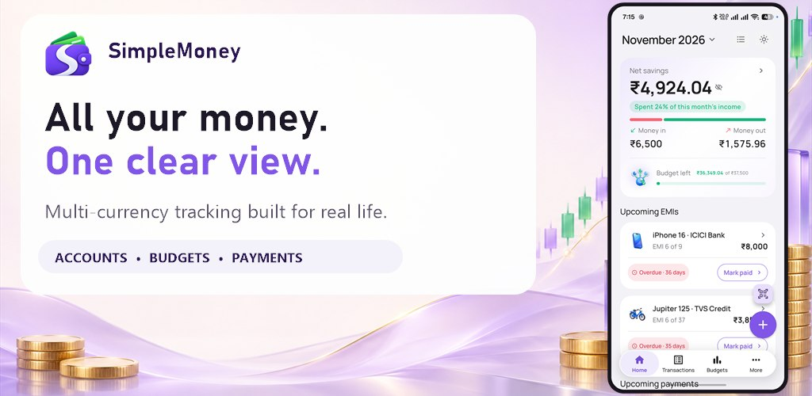
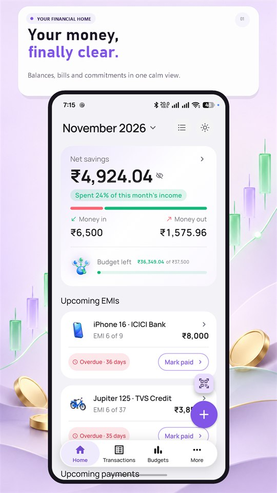
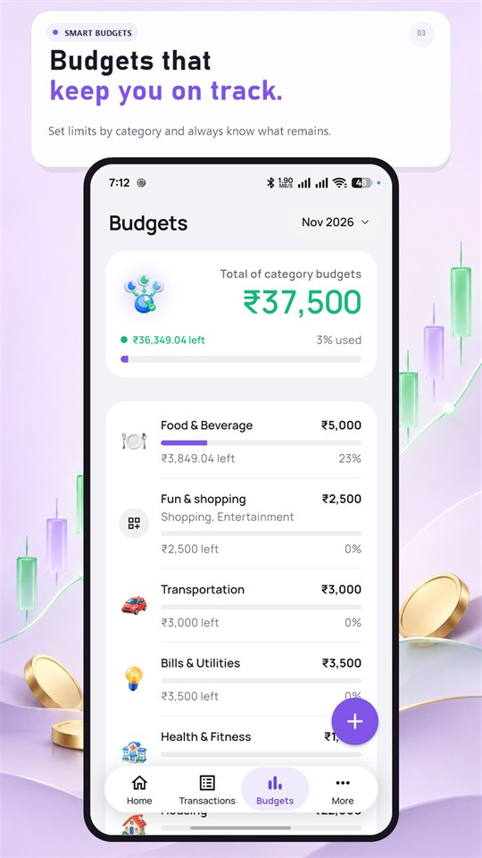
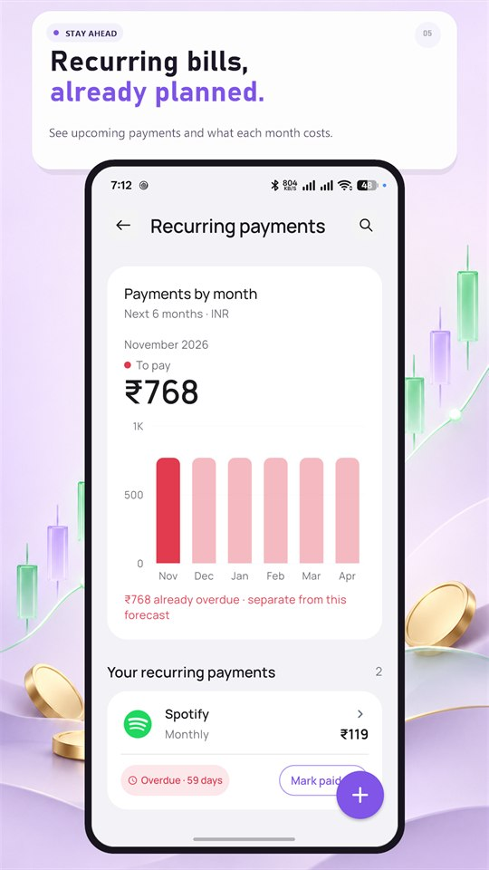
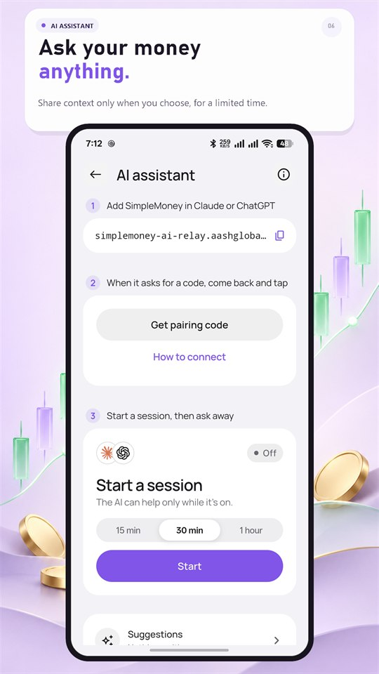
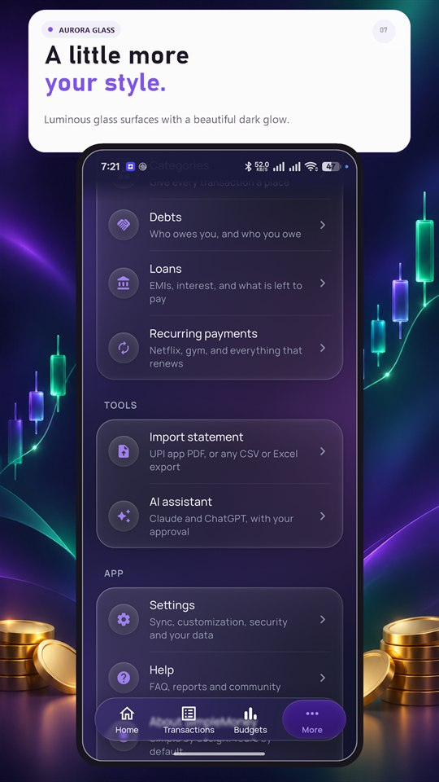
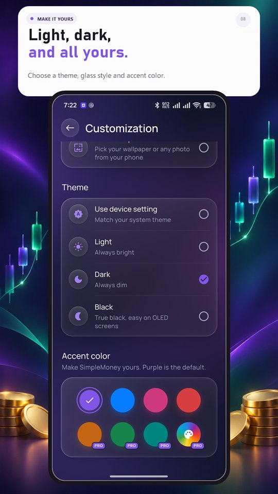

<div align="center">

[](https://play.google.com/store/apps/details?id=com.aash591.SimpleMoney)

# SimpleMoney

**A free, private expense manager and budget planner for Android.**<br>
No account. Works offline. Reads your bank SMS. Your data stays on your phone.

<p>
  <a href="https://play.google.com/store/apps/details?id=com.aash591.SimpleMoney"></a>
  <a href="https://simplemoney.aashglobal.in"></a>
  <a href="https://simplemoney.aashglobal.in/privacy"></a>
</p>


</div>

## Screenshots

<table>
  <tr>
    <td align="center"></td>
    <td align="center"></td>
    <td align="center"></td>
    <td align="center"></td>
  </tr>
  <tr>
    <td align="center"><b>Home</b></td>
    <td align="center"><b>Transactions</b></td>
    <td align="center"><b>Budgets</b></td>
    <td align="center"><b>Loans</b></td>
  </tr>
  <tr>
    <td align="center"></td>
    <td align="center"></td>
    <td align="center"></td>
    <td align="center"></td>
  </tr>
  <tr>
    <td align="center"><b>Recurring payments</b></td>
    <td align="center"><b>AI assistant</b></td>
    <td align="center"><b>Aurora glass</b></td>
    <td align="center"><b>Make it yours</b></td>
  </tr>
</table>

## Overview

SimpleMoney is built around one small idea. Every transaction answers two questions, and the app keeps them apart:

- **What was it for?** That is the **category** (Food, Fuel, Bills…).
- **Where did the money come from?** That is the **account** (Cash, bank, card, wallet…).

Food paid from Cash and Food paid from a bank are both just **Food**. Moving money between your own accounts is a transfer, not spending.

### How it works

1. **Your bank SMS arrives.** SimpleMoney reads it on your phone and turns it into a transaction waiting for review. Nothing is uploaded.
2. **You check it.** Confirm, fix the category, or skip. Prefer to type? Adding an expense is amount, category, account, save.
3. **You see where you stand.** Budgets, balances, loans, bills due and net savings update on the Home screen.

## Why SimpleMoney

**Key Differentiators**

- 🔒 **Private by Design** — Your transactions stay on your phone; no sign-up, no login, no server holding your data. Bank SMS is read on the device and never uploaded. The internet is used only by features you switch on ([see Privacy](https://simplemoney.aashglobal.in/privacy))
- ⚡ **Zero Setup** — Grant SMS permission and your first transactions appear for review; no account to create, works offline
- 🌍 **Works in Your Country** — Ready-made bank SMS rules for 25 countries, and a way to teach the app any bank it doesn't know yet
- 🤖 **AI That Asks First** — Connect Claude or ChatGPT to ask about your own money; the AI can only *suggest* changes, and nothing happens until you approve it
- 🆓 **Free and Open Source** — AGPL v3 licensed; an optional [Pro](#simplemoney-pro) upgrade helps support the solo developer

**Core Features**

- 📩 **Smart SMS Parsing** — Bank messages become transactions waiting for review, with rules for India, the UK, the USA, UAE, Saudi Arabia, Germany, France, Turkey, Nigeria, Kenya, Pakistan, Bangladesh, Sri Lanka, Thailand and more. Mark the amount, account and merchant once to teach it a new bank
- 💱 **Multi-Currency** — Any currency per account, a main currency for combined totals, and daily rates fetched only if you use two or more currencies; cached rates work offline
- 🏷️ **Categories** — Sub-categories, soft 3D icons and real bank and brand logos for 40+ countries
- 🎯 **Budgets** — A monthly total plus a limit per category, with what is left shown on Home
- 🏦 **Accounts** — Cash, bank, card, wallet or broker, each with its own balance, currency and history
- 💳 **Loans and EMIs** — Principal repaid and remaining, upcoming and overdue EMIs, one tap to record a payment
- 🤝 **Debts** — Money you lent or borrowed, person by person
- 🔁 **Recurring Payments** — Subscriptions, rent, premiums and SIPs, with a six-month forecast and reminders before they are due
- 📥 **Statement Import** — UPI app PDFs (including password-protected ones), CSV and Excel exports; map the columns once and reuse the layout
- 📷 **UPI QR** — Scan a QR code and record the payment
- 📈 **Portfolio** — Stocks, ETFs, mutual funds, crypto, forex and gold, at a broker or in hand, with prices

**More Features**

- ☁️ **Encrypted Backup** — Optional Google Drive backup into your own account, encrypted with a PIN that is never stored, then restore on a new phone
- 🎨 **Looks** — Light, dark, true black and the Aurora glass style, with accent colors and your own wallpaper
- 🔐 **App Lock** — Fingerprint or PIN
- 🚀 **Quick Add** — Home-screen shortcuts to add an expense, an income or scan a QR
- 📤 **Your Data** — Export and import, plus an activity log of what changed
## AI assistant

1. In the app, open **More › AI assistant** and add SimpleMoney in Claude or ChatGPT (any MCP app works).
2. Tap **Get pairing code** when it asks for one.
3. Start a session for 15 minutes, 30 minutes or an hour. The AI can help only while it is on.

Ask things like "what did I spend on food last month?" or "find my subscriptions". When the AI wants to add or change something, it lands in **More › AI assistant › Suggestions** and waits for your approval.

Fixes you teach the app, such as SMS formats and statement layouts, can optionally be shared with the community with no messages, amounts or names in them.

## Privacy

- No sign-up and no login.
- Your data lives on your device.
- The internet is used only for things you switch on: Drive backup, exchange rates, price lookups, the AI connection and community sharing.
- Bank SMS is read locally and not uploaded.

Read the full [privacy policy](https://simplemoney.aashglobal.in/privacy).

## SimpleMoney Pro

Tracking your money is free, forever. **Pro** is an optional purchase that adds unlimited budgets, every look and accent color, the AI assistant, and removes ads. It helps keep SimpleMoney going.

## Run it from source

You need the [Flutter SDK](https://docs.flutter.dev/get-started/install) and the Android SDK.

```sh
cd app
flutter pub get
flutter test
flutter run
```

Optional online features read settings from `app/.env` (copy `app/.env.example`). Without them the app still builds and runs. Release builds need your own signing key.

| Folder | What it is |
|---|---|
| `app/` | The Flutter app |
| `app/packages/universal_bank_sms_parser/` | The bank SMS parser, with per-country rules |
| `app/packages/drive_authorization/` | Google Drive sign-in package |
| `WebDoc/` | The website, privacy policy and terms |
| `readme/` | Developer notes and the pictures used here |

Flutter and Dart on Android, with a local SQLite database (Drift). Amounts are stored as exact integer minor units, so totals never drift. Dependencies are kept minimal.

## Contributing

Bug reports and pull requests are welcome. Please run `flutter analyze` and `flutter test` first, and keep the main rule in mind: **prefer simplicity.** If a feature makes everyday money tracking slower or more confusing, it belongs under advanced options.

Never post real bank messages, statements, account numbers or names in an issue or pull request. Black them out first.

## License

Made by Aash Global. Licensed under the [GNU Affero General Public License v3.0](LICENSE) (AGPL-3.0).

You can use, change and share this code. If you distribute it, or run a modified version as a network service, you must publish your full source under the same license. Copyright and license notices must stay.

<div align="center">

[Google Play](https://play.google.com/store/apps/details?id=com.aash591.SimpleMoney) · [Website](https://simplemoney.aashglobal.in) · [Guides](https://simplemoney.aashglobal.in/guides) · [Privacy](https://simplemoney.aashglobal.in/privacy) · [Terms](https://simplemoney.aashglobal.in/terms)

</div>
